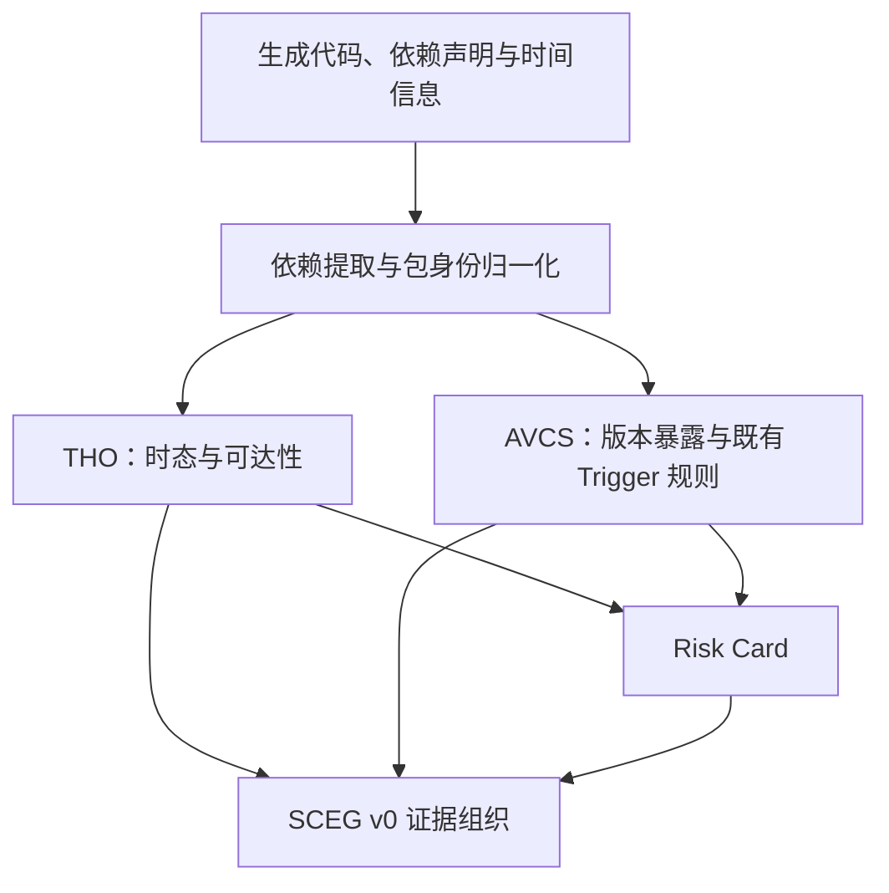

# CodeSentry-Gen

面向 LLM 生成代码的依赖风险分析研究原型。项目围绕两类不确定性展开：包身份与时间信息是否可靠，以及 API 用法、依赖声明和漏洞影响版本之间是否存在冲突。

本仓库提供阶段性源码版本，包含 THO、轻量 SCEG v0、AVCS 版本分析与既有 Trigger 规则，以及知识构建和人工审核准备接口。当前阶段已完成版本范围证据修复；逐漏洞协作审核及后续语义分析属于后续工作。

## 系统组成

| 模块 | 本阶段能力 | 主要源码入口 |
| --- | --- | --- |
| 依赖提取与包身份 | 提取 Python import 与依赖声明，建立 import 名称到发行包的映射 | [run_pilot.py](src/run_pilot.py)、[extractor.py](src/extractor.py)、[normalizer.py](src/normalizer.py) |
| THO | 基于生成时间、包发布时间和安装证据进行时态与可达性分析，生成风险卡 | [enrich_temporal_status.py](src/enrich_temporal_status.py)、[enrich_reachability_v2.py](src/enrich_reachability_v2.py)、[build_temporal_risk_cards.py](src/build_temporal_risk_cards.py) |
| AVCS 第一层 | 从 API 用法、依赖声明与历史发布证据约束可行版本集合 | [extract_api_calls.py](src/extract_api_calls.py)、[resolve_api_version_constraints.py](src/resolve_api_version_constraints.py)、[resolve_avcs_api_compatible_releases.py](src/resolve_avcs_api_compatible_releases.py) |
| AVCS 第二层 | 判断可行版本与漏洞影响范围的交集，保留未知或冲突证据 | [resolve_avcs_exposed_releases.py](src/resolve_avcs_exposed_releases.py)、[evaluate_avcs_overlap.py](src/evaluate_avcs_overlap.py) |
| 既有第三层规则 | 覆盖直接 API、参数条件、历史默认值和有限的 receiver-producer 场景 | [run_avcs_trigger_matcher.py](src/run_avcs_trigger_matcher.py)、[六包 Package KB](data/avcs_package_kb/) |
| SCEG v0 | 将依赖记录、分析证据和 Risk Card 关联组织为轻量证据图 | [build_pre_sceg_dependency_entities.py](src/build_pre_sceg_dependency_entities.py)、[build_sceg_v0.py](src/build_sceg_v0.py)、[Schema](schemas/sceg_schema_v0.json) |
| 知识与审核准备 | 构建 Candidate、整理语义来源、生成 LLM 请求并接收候选 Proposal，保持人工审核门 | [build_trigger_hitl_candidate.py](src/build_trigger_hitl_candidate.py)、[build_trigger_llm_request.py](src/build_trigger_llm_request.py)、[apply_trigger_llm_proposal.py](src/apply_trigger_llm_proposal.py) |
| OSV 范围修复 | 对多来源 PyPI 版本证据进行归一化与一致性判断 | [osv_pypi_release_ranges.py](src/osv_pypi_release_ranges.py)、[resolve_osv_package_catalog_constraints.py](src/resolve_osv_package_catalog_constraints.py) |

主要数据流如下。当前原型由分步脚本组织；SCEG v0 汇集已有分析结果与风险卡关联。

## 知识与代表性材料

- [六包 Package KB](data/avcs_package_kb/)：aiohttp、NumPy、PyJWT、PyYAML、requests、urllib3 的既有案例与规则。
- [API History 证据](output/avcs_api_history_scale/)：Flask、cryptography、Pillow、pandas、SQLAlchemy 的历史 API 检查材料，保留 supported、unsupported 和 unknown 等状态。
- [11 包漏洞目录](output/step7_osv_catalogs_v0/)及[范围修复统计](output/osv_multisource_repair_v2_20261011/summary.json)：208 个漏洞组，修复后为 171 resolved / 37 unresolved。
- [Pillow Candidate](output/step7_hitl_batch_v0/step7_pillow_ghsa_45hq_cxwh_f6vc/candidate.json)与[LLM Proposal](output/step7_batch_review_v0/batch_004_llm_proposals_v1/step7_pillow_ghsa_45hq_cxwh_f6vc/llm_proposal.json)：展示候选构建和审核准备的数据结构。

Candidate 的审核状态为 `requires_review`。Proposal 中的 `eligible` 表示模型提出的候选分类，最终人工审核状态以 review_gate 为准。

## 运行与复现

建议在独立 Python 3.10 环境和工作副本中运行。依赖见 [requirements.txt](requirements.txt)，离线复现命令、输入与输出位置见[运行与验证说明](docs/VALIDATION.md)。

2026-10-24 在 Windows、新建 Python 3.10 venv 中完成的代表性离线验收包括：

| 项目 | 结果 |
| --- | --- |
| 六包 KB、原始 Candidate、已有 Proposal 的 Schema 与相应检查 | 通过 |
| AVCS 存档一致性检查 | 46/46 |
| 旧 Trigger 匹配检查 | 31/31 |
| OSV 版本范围修复回归 | 29/29 |
| THO → Risk Card → SCEG 受控链路 | 4 条记录、4 张卡、4 条通过 Schema 的 SCEG |
| 11 包冻结目录重放 | 208 组；171 resolved / 37 unresolved |
| LLM 请求与 Proposal 合并接口 | 临时验收上下文中通过，人工审核门保持待审核 |

上述结果对应约定输入与执行路径，作为功能级验收记录。历史输出存档保留其原始统计口径；论文主实验与检测性能评估另行组织。

## 文档与阅读顺序

1. [实现范围与研究阶段](docs/STAGE_SCOPE.md)：区分现有实现、准备接口与后续研究目标。
2. [运行与验证说明](docs/VALIDATION.md)：安装环境、运行离线示例、解释验证结果。
3. [版本来源与记录口径](docs/SOURCE_VERSIONS.md)：定位来源提交及阶段整理改动。
4. [总体设计参考原文](CodeSentry_Gen_Temporal_Dependency_Risk_v2_CCF-A.md)：项目问题定义、目标架构与评估设计。
5. [THO 历史验证汇总](output/tho_validation_final_summary_v2.md)、[SCEG 历史验证汇总](output/sceg_v0_final_summary.md)：查看已有记录及其数据集口径。

源码、配置、Schema、验证工具分别位于 [src](src/)、[config](config/)、[schemas](schemas/)、[tests](tests/) 与 [scripts](scripts/)。[output](output/) 保存阶段证据和历史结果。[AGENTS.md](AGENTS.md) 提供仓库维护规范。
